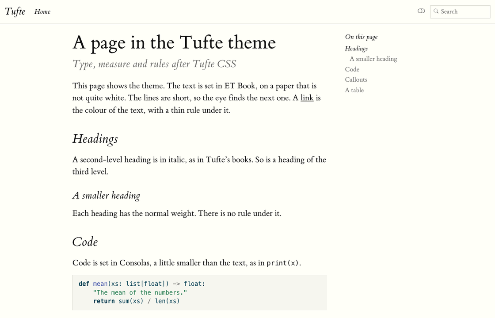

# smalldocs-tufte

A theme that gives a [smalldocs](https://github.com/rahuldave/smalldocs) site, or a
[Quarto](https://quarto.org) site, the look of [Tufte CSS](https://edwardtufte.github.io/tufte-css/).
The text is set in ET Book on a cream paper, in a narrow column. Headings are in
italic, links are underlined in the colour of the text, and tables have only three
rules. The theme has a light mode and a dark mode.

See it live: **<https://rahuldave.github.io/smalldocs-tufte/>** (it opens at rahuldave.com/smalldocs-tufte/), a demo site built from `example/`.



## With smalldocs

Add the theme to your project:

```sh
smalldocs add rahuldave/smalldocs-tufte
```

This copies the theme into `_extensions/tufte/`. Then set the theme in `_smalldocs.yml`:

```yaml
theme: tufte
```

In a `_quarto.yml`, put it under `smalldocs:`:

```yaml
smalldocs:
  theme: tufte
```

The site gets both modes, with a button in the navbar that switches between them.
`smalldocs themes` lists the themes of a project, and where each came from.

### Side notes

Tufte puts notes in the margin, beside the text. smalldocs 0.2.0 and later does the same, and this
theme gives the notes Tufte's look. Put each footnote in the margin with one line in the config:

```yaml
reference-location: margin
```

A div with the class `.column-margin` is a margin note with no number, and `[a remark]{.aside}` is a
short one inside a sentence. `fig-cap-location: margin` puts captions beside their figures, and
`.column-page` makes a figure as wide as the page. The demo's
[Side notes](https://rahuldave.com/smalldocs-tufte/guide/side-notes.html) page shows each of them.
The same classes work in Quarto.

## With Quarto

```sh
quarto add rahuldave/smalldocs-tufte
```

Then use the format in `_quarto.yml`:

```yaml
format:
  tufte-html:
    toc: true
```

The Quarto theme is the same rules, written as Sass layers in `tufte.scss`
(light) and `tufte-dark.scss` (dark). Quarto follows the mode that the browser
prefers.

## On any Bootstrap page

`tufte.css` and `tufte-dark.css` are whole Bootstrap 5.3 stylesheets, as
Bootswatch themes are. Link one in place of `bootstrap.min.css`, and keep the
`et-book` folder next to it. Buttons, alerts, cards, lists, pagination and
progress bars take the ink of the text in place of Bootstrap's blue.

## Building

The CSS, Sass and foundation manifest in `_extensions/tufte/` are built. Do not edit them; edit the sources and build again:

| Source | What it holds |
|---|---|
| `src/common.css` | The Tufte rules: type, measure, headings, links, tables, notes in the margin, navbar and sidebar |
| `src/foundations.json` | Authoritative versioned paired colors, role references, states, typography, spacing and shape; published verbatim as `foundations.json` |
| `scripts/foundations.py` | Local generation of shared CSS variables and Quarto Sass defaults from the contract |
| `src/fonts.css` | The ET Book fonts |
| `src/quarto.css` | The few selectors that only Quarto needs |
| `vendor/bootstrap/bootstrap.min.css` | Bootstrap 5.3.8, MIT. Each CSS file starts with all of it, as a Bootswatch theme does |

```sh
sh scripts/build.sh
```

The script writes `tufte.css` and `tufte-dark.css` for smalldocs, and `tufte.scss` and `tufte-dark.scss` for
Quarto. `scripts/dark_root.py` puts Bootstrap's dark colours on the whole page in the dark file.
`scripts/embed_fonts.py` puts the fonts inside the Sass files, because Quarto cannot find a font file next to
the theme. The tests on GitHub build the files again and fail if they differ from the ones in the repository.

## The demo site

`example/` is the demo site, with a few guide pages and a listing of notes. To
build it, copy the theme into it, then render it. `smalldocs add .` copies the
last commit, so commit a change to the theme first:

```sh
smalldocs add . --dir example --force
smalldocs render example
```

`smalldocs publish gh-pages example` publishes it to the `gh-pages` branch.

## Tests

`tests/test_theme.py` checks that each stylesheet is a whole Bootstrap 5.3
theme. Each has Bootstrap's banner, every `--bs-*` variable that a Bootswatch
theme sets, a dark colour mode and the core components. No `url()` points
outside the folder. Run it with `pytest tests`. It needs only Python and
pytest, and GitHub runs it on each push.

On each push and pull request, and each Monday, GitHub also builds `example/`
with the latest smalldocs from PyPI. It builds with `--strict`, so the build
fails on any warning. A new release of smalldocs that breaks the theme shows
within a week.

## What is in the folder

`_extensions/tufte/` is what `smalldocs add` and `quarto add` copy into a project:

| File | What it is |
|---|---|
| `smalldocs.yml` | The theme for smalldocs: a CSS file for each mode, and the favicon |
| `tufte.css`, `tufte-dark.css` | Built: Bootstrap 5.3.8, then the Tufte rules. smalldocs compiles no Sass, so each file holds all of Bootstrap |
| `_extension.yml`, `tufte.scss`, `tufte-dark.scss` | The theme for Quarto; the Sass files are built. The fonts are in them, as data URIs |
| `et-book/` | The ET Book fonts |

The rest of the repository makes and tests the theme:

| Folder | What it is |
|---|---|
| `src/` | The sources of the theme; see [Building](#building) |
| `scripts/` | `build.sh`, which builds the theme, and its two helpers |
| `vendor/bootstrap/` | Bootstrap 5.3.8 and its licence |
| `example/` | The demo site |
| `tests/` | The tests that the theme is a whole Bootstrap 5.3 stylesheet |

## Credits

The look is that of [Tufte CSS](https://github.com/edwardtufte/tufte-css), by Dave
Liepmann and others. The fonts are [ET Book](https://github.com/edwardtufte/et-book),
by Dmitry Krasny, Bonnie Scranton and Edward Tufte. The CSS starts with
[Bootstrap](https://getbootstrap.com/). All three are under the MIT License, and so is
this theme. See [LICENSE](LICENSE).

## Foundation contract and acceptance checks

Version 0.2.0 adopts an explicit light/dark foundation contract. Original palette
anchors remain in `src/foundations.json`; CSS reads named roles rather than using
brand colors as status colors. The built manifest is identical to that source.
No runtime dependency on another theme repository is needed.

Reading uses the browser's preferred root (16px reference), 20px ET Book body at 1.6 line height, 36px page titles,
optional 48px `.editorial-title`/`.display-title`, 16px controls and 14px metadata.
The main measure remains at most 640px. Notes flow inline on narrow screens; their position relative to the reference follows each renderer. Values are emitted in rem and follow browser
zoom. The contract's separate presentation profile retains regular projected
headings; reading sections keep Tufte's italic character. Ordinary groups and
cards are transparent, borderless, square, shadowless and have no inner padding.
Code and actual form controls retain functional boundaries.

Achromatic links stay underlined, including hover. The optional blue highlight
pairs its own fill and ink. Focus uses an opaque outline with an offset; primary
hover and checkbox/radio marks have explicit paired ink. Status colors need words
and icons too. Use native `disabled` on unavailable controls, `aria-selected` or
`aria-current` with a non-color selected cue, and `aria-invalid` plus
`aria-describedby` pointing to an explanatory error. CSS cannot supply those
behaviors or accessible words for application authors. Token checks target 5:1
for ordinary text, 4.5:1 action pairs and 3:1 meaningful boundaries; they do not
certify whole-page accessibility or projection.

Run the build, unit checks and actual renderer fixtures:

```sh
sh scripts/build.sh
uv run --with pytest python -m pytest -q
python3 scripts/verify_consumers.py /tmp/tufte-foundations-qa
python3 -m http.server 8860 --bind 127.0.0.1 --directory /tmp/tufte-foundations-qa
```

The last command serves `smalldocs/_site/index.html` and
`quarto/_site/index.html`; `narrow.html` embeds both at 390px. Inspect desktop and narrow widths in both modes;
exercise focus, checkbox, primary action, selection and disabled controls.
The fixture builder copies **current generated files** directly into clean
consumers. `smalldocs add .` installs the last commit, so running that command
against uncommitted changes does not verify those changes. SmallDocs 0.5.5 is
pinned for the strict acceptance build; Quarto must be installed separately.
Quarto consumes scoped Sass layers and embedded fonts, never the standalone
Bootstrap stylesheet. Fonts and their original licenses remain unchanged.

### Semantic actions (0.2.1)

Filled and outline success, warning, danger and information buttons reuse the
contract's state fill/ink pairs with the tested neutral control boundary around the action. Hover, keyboard focus and active
states reverse the same tested ink/fill pair; disabled actions use opaque
neutral disabled roles. Outline-secondary stays neutral. Retain a state word
or icon on each action: the fixture labels examples explicitly. No stock
Bootstrap colors or vendor files are changed.

The acceptance page includes base, active, native-disabled and disabled-active examples for all
nine variants. `tests/browser-state-actions.mjs` exports `inspectStateActions`
for CUA's read-only `tab.playwright.evaluate`; it reports actual computed text,
background, boundary and contrast for each action. Run it on each real consumer
in both modes, and after normal keyboard focus or pointer interaction. Narrow
layout is checked manually through the existing 390px wrapper.
