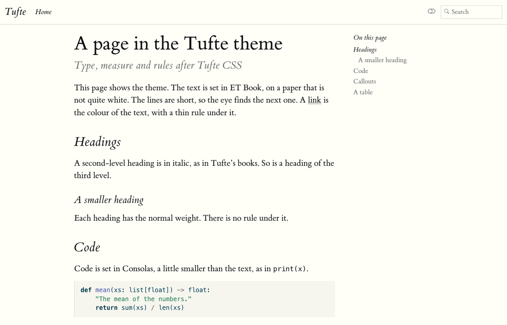

# smalldocs-tufte

A theme that gives a [smalldocs](https://github.com/rahuldave/smalldocs) site, or a
[Quarto](https://quarto.org) site, the look of [Tufte CSS](https://edwardtufte.github.io/tufte-css/).
The text is set in ET Book on a cream paper, in a narrow column. Headings are in
italic, links are underlined in the colour of the text, and tables have only three
rules. The theme has a light mode and a dark mode.

See it live: **<https://rahuldave.github.io/smalldocs-tufte/>** (it opens at rahuldave.com/smalldocs-tufte/), a demo site built from `example/`.



## With smalldocs

Add the theme to your project:

```sh
smalldocs add rahuldave/smalldocs-tufte
```

This copies the theme into `_extensions/tufte/`. Then set the theme in `_smalldocs.yml`:

```yaml
theme: tufte
```

In a `_quarto.yml`, put it under `smalldocs:`:

```yaml
smalldocs:
  theme: tufte
```

The site gets both modes, with a button in the navbar that switches between them.
`smalldocs themes` lists the themes of a project, and where each came from.

### Side notes

Tufte puts notes in the margin, beside the text. smalldocs 0.2.0 and later does the same, and this
theme gives the notes Tufte's look. Put each footnote in the margin with one line in the config:

```yaml
reference-location: margin
```

A div with the class `.column-margin` is a margin note with no number, and `[a remark]{.aside}` is a
short one inside a sentence. `fig-cap-location: margin` puts captions beside their figures, and
`.column-page` makes a figure as wide as the page. The demo's
[Side notes](https://rahuldave.com/smalldocs-tufte/guide/side-notes.html) page shows each of them.
The same classes work in Quarto.

## With Quarto

```sh
quarto add rahuldave/smalldocs-tufte
```

Then use the format in `_quarto.yml`:

```yaml
format:
  tufte-html:
    toc: true
```

The Quarto theme is the same rules, written as Sass layers in `tufte.scss`
(light) and `tufte-dark.scss` (dark). Quarto follows the mode that the browser
prefers.

## On any Bootstrap page

`tufte.css` and `tufte-dark.css` are whole Bootstrap 5.3 stylesheets, as
Bootswatch themes are. Link one in place of `bootstrap.min.css`, and keep the
`et-book` folder next to it. Buttons, alerts, cards, lists, pagination and
progress bars take the ink of the text in place of Bootstrap's blue.

## Building

The four files in `_extensions/tufte/` are built. Do not edit them; edit the sources and build again:

| Source | What it holds |
|---|---|
| `src/common.css` | The Tufte rules: type, measure, headings, links, tables, notes in the margin, navbar and sidebar |
| `src/light-root.css`, `src/light-dark-parts.css`, `src/dark.css` | The colours of the light mode and the dark mode |
| `src/fonts.css` | The ET Book fonts |
| `src/defaults-light.scss`, `src/defaults-dark.scss`, `src/quarto.css` | The Sass variables and the rules that only Quarto needs |
| `vendor/bootstrap/bootstrap.min.css` | Bootstrap 5.3.8, MIT. Each CSS file starts with all of it, as a Bootswatch theme does |

```sh
sh scripts/build.sh
```

The script writes `tufte.css` and `tufte-dark.css` for smalldocs, and `tufte.scss` and `tufte-dark.scss` for
Quarto. `scripts/dark_root.py` puts Bootstrap's dark colours on the whole page in the dark file, and
`scripts/embed_fonts.py` puts the fonts inside the Sass files, because Quarto cannot find a font file next to
the theme. The tests on GitHub build the files again and fail if they differ from the ones in the repository.

## The demo site

`example/` is the demo site, with a few guide pages and a listing of notes. To
build it, copy the theme into it, then render it:

```sh
smalldocs add . --dir example --force
smalldocs render example
```

To publish it to the `gh-pages` branch: `smalldocs publish gh-pages example`.

## Tests

`tests/test_theme.py` checks that each stylesheet is a whole Bootstrap 5.3
theme: it has Bootstrap's banner, every `--bs-*` variable that a Bootswatch
theme sets, a dark colour mode, the core components, and no `url()` that points
outside the folder. Run it with `pytest tests`. It needs only Python and
pytest, and GitHub runs it on each push.

## What is in the folder

`_extensions/tufte/` is what `smalldocs add` and `quarto add` copy into a project:

| File | What it is |
|---|---|
| `smalldocs.yml` | The theme for smalldocs: a CSS file for each mode, and the favicon |
| `tufte.css`, `tufte-dark.css` | Built: Bootstrap 5.3.8, then the Tufte rules. smalldocs compiles no Sass, so each file holds all of Bootstrap |
| `_extension.yml`, `tufte.scss`, `tufte-dark.scss` | The theme for Quarto; the Sass files are built. The fonts are in them, as data URIs |
| `et-book/` | The ET Book fonts |

The rest of the repository makes and tests the theme:

| Folder | What it is |
|---|---|
| `src/` | The sources of the theme; see [Building](#building) |
| `scripts/` | `build.sh`, which builds the theme, and its two helpers |
| `vendor/bootstrap/` | Bootstrap 5.3.8 and its licence |
| `example/` | The demo site |
| `tests/` | The tests that the theme is a whole Bootstrap 5.3 stylesheet |

## Credits

The look is that of [Tufte CSS](https://github.com/edwardtufte/tufte-css), by Dave
Liepmann and others. The fonts are [ET Book](https://github.com/edwardtufte/et-book),
by Dmitry Krasny, Bonnie Scranton and Edward Tufte. The CSS starts with
[Bootstrap](https://getbootstrap.com/). All three are under the MIT License, and so is
this theme. See [LICENSE](LICENSE).
