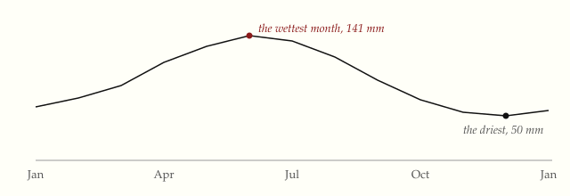

A graphic sits in the column of the text, as wide as the text, so that the
words and the picture are read together. Its caption is small and in italic.

{#fig-rain}

The figure above has no gridlines and no box. Two labels mark the months that
matter, and the reader can find the rest on the line.

## Tables

A table has three rules: a heavy one above, a light one under the header, and
a heavy one below. There are no lines between the rows, and the numbers line
up on the right.

| Book                                           | Year | Pages |
|:-----------------------------------------------|-----:|------:|
| The Visual Display of Quantitative Information | 1983 |   197 |
| Envisioning Information                        | 1990 |   126 |
| Visual Explanations                            | 1997 |   156 |
| Beautiful Evidence                             | 2006 |   213 |

A wide table scrolls in its own box, so the page does not.

| Month | Jan | Feb | Mar | Apr | May | Jun | Jul | Aug | Sep | Oct | Nov | Dec |
|:------|----:|----:|----:|----:|----:|----:|----:|----:|----:|----:|----:|----:|
| Rain, mm | 78 | 84 | 93 | 112 | 128 | 141 | 136 | 120 | 98 | 81 | 67 | 50 |
| Days of rain | 11 | 12 | 13 | 15 | 16 | 17 | 17 | 15 | 13 | 11 | 10 | 8 |
